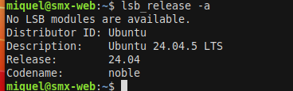
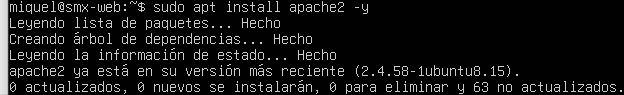
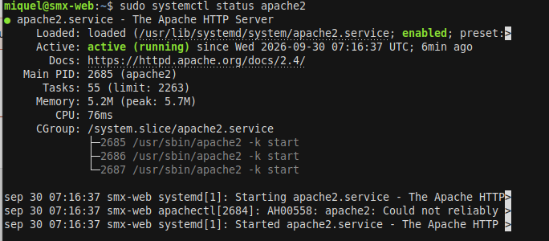
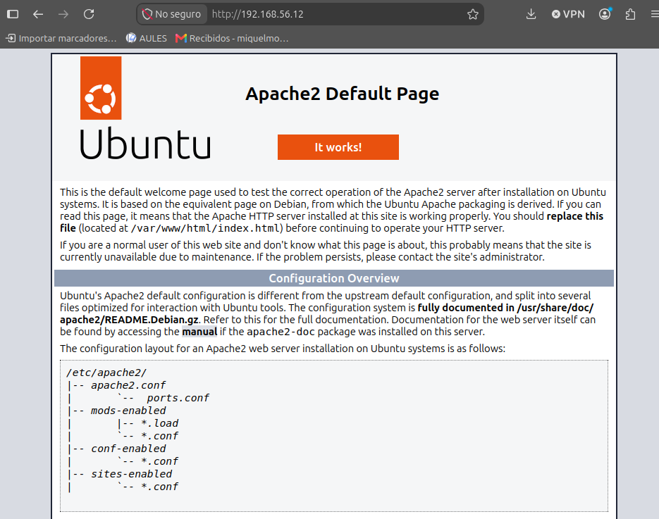
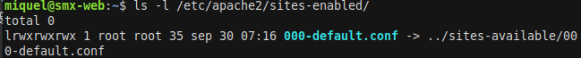

# Instalación y Securización de Apache

## Captura
Es una imagen despues de actualizar.



-----------------------------------
## Instalacion de apache2


A la hora de instalar se instlaron paquetes adicionales como independecias: 
**libfwupd2 y libgusb2**
Apache: permite el tráfico básico necesario para que funcione el servidor web.

Apache Full: permite todo el tráfico de Apache, incluyendo conexiones HTTP y HTTPS.

Apache Secure: permite únicamente el tráfico HTTPS, que está cifrado y es más seguro.
----------------------------------
## Comprobación del funcionamiento

### Captura
Imagen del status de apache2



### Captura del navegador
 

-----------------------------------------------------------
 ## Diferencia de los perfiles de Apache
**Apache**: permite el tráfico básico necesario para que funcione el servidor web.

**Apache Full**: permite todo el tráfico de Apache, incluyendo conexiones HTTP y HTTPS.

**Apache Secure**: permite únicamente el tráfico HTTPS, que está cifrado y es más seguro.
## Apartado 4. Comandos principales de administración

| Comando | Función |
|---|---|
| `sudo systemctl start apache2` | Inicia el servidor Apache. |
| `sudo systemctl stop apache2` | Apaga el servicio Apache. |
| `sudo systemctl restart apache2` | Reinicia Apache para aplicar cambios. |
| `sudo systemctl reload apache2` | Actualiza la configuración sin reiniciar el servicio. |
| `sudo systemctl enable apache2` | Configura Apache para iniciarse al arrancar el sistema. |
| `sudo systemctl disable apache2` | Evita que Apache se inicie automáticamente. |
| `apache2ctl configtest` | Comprueba si la configuración tiene errores. |
| `apache2ctl -S` | Muestra los sitios web virtuales configurados. |
| `apache2ctl -M` | Muestra los módulos de Apache disponibles y cargados. |
| `a2enmod / a2dismod` | Habilita o deshabilita módulos de Apache. |
| `a2ensite / a2dissite` | Habilita o deshabilita sitios web configurados. |
| `a2enconf / a2disconf` | Habilita o deshabilita configuraciones adicionales. |

Conviene usar `reload` cuando modificas la configuración de Apache y quieres aplicarla sin interrumpir las conexiones activas. Usa `restart` cuando necesitas reiniciar completamente el servicio.

---------------------------------------
## Apartado 5. Ficheros y Practicadirectorios importantes

| Ruta | Descripción |
|---|---|
| `/etc/apache2/apache2.conf` | Archivo de configuración principal. |
| `/etc/apache2/ports.conf` | Define los puertos donde escucha Apache. |
| `/etc/apache2/sites-available/` | Contiene los sitios web configurados disponibles. |
| `/etc/apache2/sites-enabled/` | Contiene los sitios web activados. |
| `/etc/apache2/mods-available/` y `mods-enabled/` | Contienen los módulos disponibles y activados. |
| `/etc/apache2/conf-available/` y `conf-enabled/` | Contienen las configuraciones adicionales disponibles y activadas. |
| `/etc/apache2/envvars` | Define variables de entorno de Apache. |
| `/var/www/html/` | Directorio donde se guardan los archivos web por defecto. |
| `/var/log/apache2/access.log` | Guarda el registro de accesos al servidor. |
| `/var/log/apache2/error.log` | Guarda los errores del servidor. |
### Captura contenido /etc/apache2

### Pregunta: ¿Por qué Apache usa enlaces simbólicos entre los directorios *-available y *-enabled

Para poder activar o desactivar sitios, módulos y configuraciones fácilmente, sin mover ni duplicar los archivos originales. Los directorios `*-available` guardan los disponibles y `*-enabled` contiene enlaces a los que están activados.

--------------------------------------------------

## Apartado 6. Modificaciones típicas del servicio

## Apartado 7. Módulos de Apache
| Módulo | Función |
|---|---|
| `mod_rewrite` | Reescritura de URL |
| `mod_headers` | Manipulación de cabeceras HTTP |
| `mod_ssl` | Soporte HTTPS |
| `mod_dir` | Gestión de ficheros índice (`index.html`) |
| `mod_alias` | Redirecciones y alias de rutas |
| `mod_auth_basic` | Autenticación básica |
| `mod_status` | Página de estado del servidor |
| `mod_php` / PHP-FPM | Ejecución de PHP (opcional) |

**Pregunta**
Apache puede mostrar un error de configuración o dejar de funcionar correctamente porque el módulo dependiente necesita el módulo desactivado.

------------------------
 ## Apartado 8. Varios sitios en un mismo servidor

En la imagen 11 se ve cómo creé dos directorios para alojar los sitios web y añadí una página de inicio a cada uno:
```Apache
sudo mkdir -p /var/www/sitio1 /var/www/sitio2
echo "<h1>Bienvenido a SITIO 1</h1>" | sudo tee /var/www/sitio1/index.html
echo "<h1>Bienvenido a SITIO 2</h1>" | sudo tee /var/www/sitio2/index.html
```

