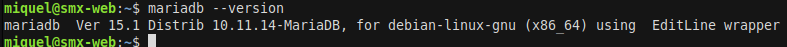
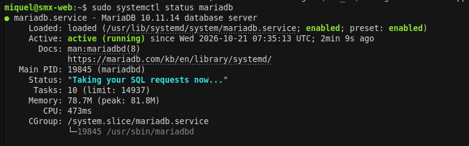
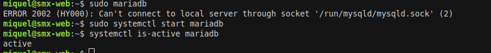
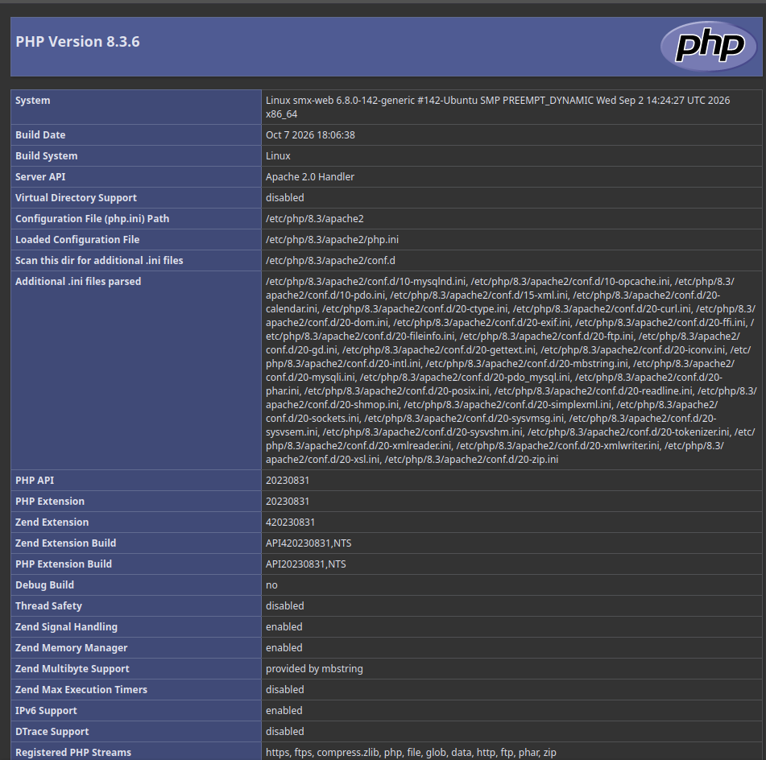
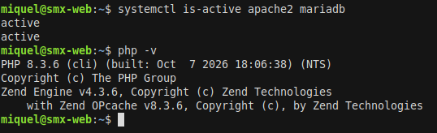

# Instalacion MariaDB y PHP


## Instalacion MariaDB

## Apartado 1. Preparacion del sistema

Activé el sitio predeterminado de Apache y recargué el servicio. Después actualicé los paquetes y comprobé que Apache seguía activo.

```bash
sudo a2ensite 000-default.conf
sudo systemctl reload apache2
sudo apt update
sudo apt upgrade -y
systemctl is-active apache2
```

**Explicación:** `a2ensite` habilita el sitio predeterminado de Apache. La recarga aplica el cambio sin apagar el servicio. `apt update` actualiza el índice de paquetes y `apt upgrade` instala las actualizaciones disponibles. Por último, `systemctl is-active` permite comprobar si Apache está funcionando.


## 2. Instalación de MariaDB

Instalé el servidor MariaDB y consulté su versión para comprobar que el paquete quedó disponible.

```bash
sudo apt install mariadb-server -y
mariadb --version
```

**Explicación:** `mariadb-server` instala el servicio que almacena y gestiona bases de datos. El comando `mariadb --version` muestra la versión instalada. El número exacto puede variar según las actualizaciones disponibles en Ubuntu.

.

## 3. Comprobación del funcionamiento

### 3.1 Estado del servicio

```bash
sudo systemctl status mariadb
systemctl is-enabled mariadb
```

**Explicación:** `status` muestra si MariaDB está ejecutándose en este momento. `is-enabled` indica si el servicio está configurado para iniciarse automáticamente al arrancar Ubuntu. Para salir de la pantalla de estado se pulsa `q`.

### 3.2 Acceso a MariaDB

```bash
sudo mariadb
```

Al entrar, el prompt debe cambiar a uno de MariaDB, por ejemplo `MariaDB [(none)]>`. Para volver al terminal:

```sql
exit
```

**Explicación:** Entré al monitor de MariaDB con permisos de administrador para confirmar que el servidor acepta conexiones. Después salí sin modificar datos.



## 4. Comandos principales del servicio

| Comando | Función |
| --- | --- |
| `sudo systemctl start mariadb` | Inicia MariaDB si está detenido. |
| `sudo systemctl stop mariadb` | Detiene MariaDB. Mientras esté parado, las aplicaciones no pueden conectarse. |
| `sudo systemctl restart mariadb` | Detiene y vuelve a iniciar MariaDB; sirve para aplicar ciertos cambios. |
| `sudo systemctl status mariadb` | Muestra el estado actual y más información del servicio. |
| `sudo systemctl enable mariadb` | Configura el inicio automático de MariaDB al arrancar el equipo. |

**Explicación:** Estos comandos permiten controlar el ciclo de vida del servicio desde `systemd`. En el uso habitual conviene comprobar el estado con `status` y dejar habilitado el inicio automático.

## 5. ¿Qué pasa si MariaDB está parado?

Detuve el servicio intencionadamente, comprobé su estado e intenté conectarme. Después lo inicié de nuevo.

```bash
sudo systemctl stop mariadb
systemctl is-active mariadb
sudo mariadb
sudo systemctl start mariadb
systemctl is-active mariadb
```

El error puede ser parecido a `Can't connect to local server through socket ...`. Significa que el cliente no encuentra el servidor MariaDB en ejecución. Tras `start`, la aplicación puede volver a conectarse si no hay otro problema de configuración.

**Respuesta a la pregunta:** Para saber si MariaDB está parado usaría `systemctl is-active mariadb`. Para intentar conectarme y confirmar el fallo de acceso usaría `sudo mariadb`. Si el estado devuelve `inactive` y la conexión falla, iniciaría el servicio con `sudo systemctl start mariadb`.



## 6. Instalación de PHP

Instalé PHP y los módulos indicados para que Apache pueda ejecutarlo y para que WordPress disponga de las extensiones habituales.

```bash
sudo apt install php libapache2-mod-php php-mysql php-curl php-gd php-mbstring php-xml php-zip php-intl -y
php -v
sudo systemctl restart apache2
sudo apache2ctl -M | grep -E "mpm|php"
php -m | grep -i mysql
```

**Explicación de los paquetes:**

| Paquete | Para qué sirve |
| --- | --- |
| `php` | Instala el lenguaje y el intérprete PHP. |
| `libapache2-mod-php` | Permite que Apache procese archivos PHP. |
| `php-mysql` | Añade a PHP los controladores para conectarse a MariaDB/MySQL. |
| `php-curl` | Permite realizar conexiones HTTP a otros servicios. |
| `php-gd` | Aporta funciones de procesamiento de imágenes. |
| `php-mbstring` | Maneja texto multibyte, como tildes y otros caracteres. |
| `php-xml` | Permite leer y generar datos XML. |
| `php-zip` | Permite trabajar con archivos ZIP, usados en instalaciones y actualizaciones. |
| `php-intl` | Aporta funciones de idioma, región y formato internacional. |

### Comprobación desde el navegador

Creé temporalmente una página de diagnóstico para comprobar que Apache ejecutaba PHP:

```bash
echo '<?php phpinfo();' | sudo tee /var/www/html/info.php
```

Abrí `http://IP_DE_TU_SERVIDOR/info.php` en el navegador y comprobé que aparecía la página de información de PHP.



Después eliminé el archivo de diagnóstico y comprobé el contenido del directorio:

```bash
sudo rm /var/www/html/info.php
ls /var/www/html
```

**Respuesta a las preguntas:** Dejar `info.php` publicado es peligroso porque revela detalles del servidor, la versión de PHP, módulos y configuración que podrían ayudar a un atacante a buscar vulnerabilidades. `php-mysql` instala la conexión que necesita PHP para consultar y modificar bases de datos MariaDB/MySQL; WordPress la necesita para acceder a sus entradas, usuarios y configuración.

## 7. Comprobación final

```bash
systemctl is-active apache2 mariadb
php -v
```

**Explicación:** Esta última comprobación confirma que los servicios web y de base de datos están activos y que PHP está instalado. Con estas piezas, el servidor queda preparado para continuar con la instalación de WordPress.

**Estado final del servidor:**

| Componente | Programa | Estado |
| --- | --- | --- |
| Sistema operativo | Ubuntu 24.04 | Instalado |
| Servidor web | Apache 2 | [Completar según el resultado] |
| Base de datos | MariaDB | [Completar versión y estado] |
| Lenguaje | PHP | [Completar versión y estado] |



## Conclusiones

La práctica me permitió preparar las dependencias necesarias para WordPress y comprobar que Apache, MariaDB y PHP pueden funcionar en el mismo servidor. También practiqué cómo consultar el estado de un servicio y cómo diagnosticar un fallo provocado al detener MariaDB.


