# Instalación de WordPress 

## 1. Conexión por SSH y comprobación del servidor

En la consola de la máquina virtual, averigua la IP:

```bash
hostname -I
```

Desde PowerShell o una terminal del ordenador, conéctate (reemplaza los valores de ejemplo):

```bash
ssh TU_USUARIO@IP_DEL_SERVIDOR
```

La primera conexión puede pedir confirmar la identidad del servidor: escribe `yes`. Introduce la contraseña de tu usuario cuando se solicite; no se mostrará mientras la escribes. Ya dentro del servidor, comprueba los servicios y PHP:

```bash
systemctl is-active apache2 mariadb
php -v
```

**Salida esperada (ejemplo orientativo; comprueba con tu captura):** `active` para ambos servicios y PHP `8.3.x`.


**Captura:** 

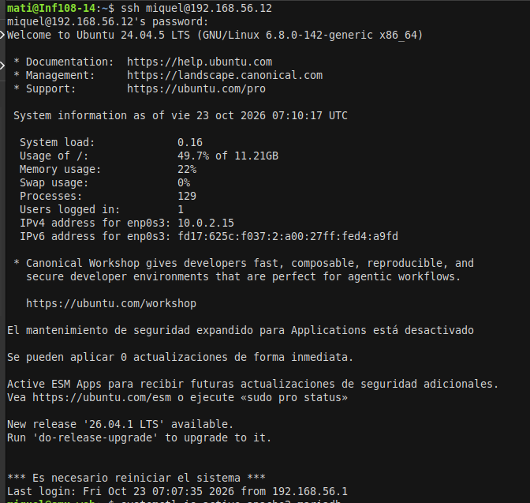

**Reflexión:** ¿Qué dos “puertas” (programas y puertos) usas para trabajar con el servidor en esta práctica y para qué sirve cada una?

**Respuesta:** SSH usa el puerto 22 y una terminal para administrar el servidor mediante texto. HTTP usa el puerto 80 y un navegador para ver y utilizar WordPress.

## 2. Dejar Apache con un único sitio

Desactiva los sitios anteriores y habilita el sitio por defecto:

```bash
sudo a2dissite sitio1.conf sitio2.conf
sudo a2ensite 000-default.conf
sudo apache2ctl configtest
sudo systemctl reload apache2
```

La prueba de configuración debe indicar `Syntax OK`. Si aparece un aviso de que Apache no conoce un nombre de servidor global, la guía propone:

```bash
echo "ServerName localhost" | sudo tee /etc/apache2/conf-available/servername.conf
sudo a2enconf servername
sudo apache2ctl configtest
sudo systemctl reload apache2
```

Comprueba el sitio activo y su carpeta:

```bash
ls /etc/apache2/sites-enabled/
grep DocumentRoot /etc/apache2/sites-enabled/000-default.conf
```

**Salida esperada (ejemplo orientativo):** solo `000-default.conf` en la primera salida; `DocumentRoot /var/www/html` en la segunda. Abre `http://IP_DEL_SERVIDOR` en el navegador: debe mostrarse la página de bienvenida de Apache o el contenido que ya tenías en esa carpeta.

**Reflexión:** ¿Qué diferencia hay entre desactivar un sitio con `a2dissite` y borrar sus ficheros? ¿Por qué ahora ves la página por defecto de Apache y antes veías sitio1?

**Respuesta:** Desactivar un sitio lo quita de la configuración activa de Apache, pero conserva sus ficheros. Borrarlos los eliminaría del servidor. Ahora Apache tiene habilitado `000-default.conf`, cuyo `DocumentRoot` es `/var/www/html`; antes atendía las peticiones el sitio que estaba activo para esa configuración.

## 3. Crear la base de datos de WordPress

Elige una contraseña de al menos 12 caracteres, usando solo letras, números y guion bajo. Guárdala en un lugar privado; **no la escribas en el repositorio ni en una captura**. En el ejemplo siguiente, reemplaza `ClaveSegura_2026` por tu clave real solo en tu terminal.

```bash
sudo mariadb
```

En el indicador de MariaDB ejecuta, una línea cada vez:

```sql
CREATE DATABASE wordpress;
CREATE USER 'wp_user'@'localhost' IDENTIFIED BY 'ClaveSegura_2026';
GRANT ALL ON wordpress.* TO 'wp_user'@'localhost';
exit
```

Las tres instrucciones deben responder `Query OK`. Verifica el acceso con el usuario nuevo:

```bash
mariadb -u wp_user -p wordpress
```

Introduce la contraseña cuando se pida. Si aparece `MariaDB [wordpress]>`, la conexión funciona; sal con `exit`.

**Qué hace cada instrucción:**

- `CREATE DATABASE wordpress;` crea la base de datos.
- `CREATE USER ... IDENTIFIED BY ...;` crea el usuario local `wp_user` y le asigna una contraseña.
- `GRANT ALL ON wordpress.* ...;` concede a ese usuario permisos sobre la base `wordpress`.


**Capturas:**

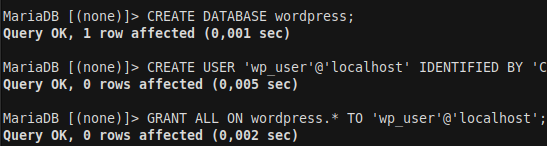
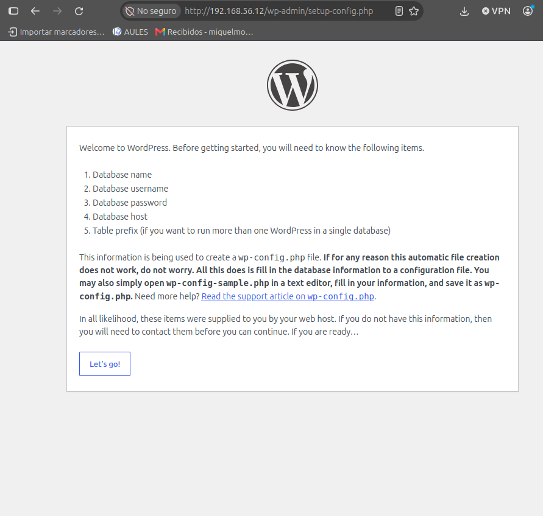

**Reflexión:** ¿Por qué crees que WordPress usa su propio usuario `wp_user` con permiso solo sobre su base y no el usuario `root` de MariaDB?

**Respuesta:** Así WordPress trabaja con una cuenta dedicada y limitada a su propia base. No necesita acceso administrativo a todo MariaDB; si la aplicación tuviera un problema, sus permisos quedan acotados.

## 4. Descargar e instalar los ficheros de WordPress

### 4.1 Descargar y descomprimir

```bash
sudo apt install wget -y
cd /tmp
wget https://wordpress.org/latest.tar.gz
tar -xzf latest.tar.gz
ls wordpress
```

`wget` descarga el archivo, `tar -xzf` lo descomprime y `ls` permite ver el contenido. Entre los elementos esperados están `index.php`, `wp-admin`, `wp-content` y `wp-config-sample.php`.

### 4.2 Copiar al directorio del sitio

```bash
sudo rm /var/www/html/index.html
sudo cp -a /tmp/wordpress/. /var/www/html/
rm -r /tmp/wordpress /tmp/latest.tar.gz
ls /var/www/html
```

Estas órdenes eliminan la página de bienvenida de Apache, copian el contenido de WordPress al directorio web, borran los archivos temporales de descarga y muestran el contenido instalado. La web se abrirá en `http://IP_DEL_SERVIDOR`. Si sigue apareciendo el contenido anterior, la guía sugiere comprobar la respuesta local:

```bash
curl -I http://localhost
```


### 4.3 Asignar permisos

```bash
sudo chown -R www-data:www-data /var/www/html
sudo find /var/www/html -type d -exec chmod 755 {} \;
sudo find /var/www/html -type f -exec chmod 644 {} \;
ls -ld /var/www/html
```

`chown` asigna recursivamente los archivos al usuario y grupo de Apache, `www-data`. Los dos `find` aplican permisos `755` a directorios y `644` a ficheros. La última salida debe mostrar `www-data` como propietario y grupo.


**Capturas:** 

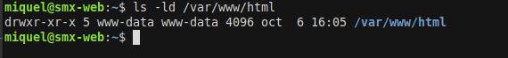
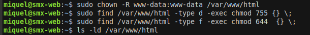

**Reflexión:** ¿Por qué hay que cambiar el propietario de la carpeta de WordPress a `www-data`? ¿Qué podría fallar si siguiera siendo tu usuario?

**Respuesta:** Apache se ejecuta como `www-data`, por lo que ese usuario necesita escribir donde WordPress guarda su configuración, imágenes o plugins. Si la carpeta perteneciera a otro usuario y Apache no tuviera permisos de escritura, esas operaciones podrían fallar.

## 5. Terminar la instalación desde el navegador

Abre `http://IP_DEL_SERVIDOR` (o `http://localhost:8080` si usas el túnel). Sigue el asistente:

1. Elige el idioma y pulsa **Continuar**.
2. En la bienvenida, pulsa **¡Vamos a ello!**.
3. En los datos de base de datos, indica:
   - Base de datos: `wordpress`
   - Usuario: `wp_user`
   - Contraseña: la que elegiste en el apartado 3 (no la copies en la memoria)
   - Servidor: `localhost`
   - Prefijo: `wp_`
4. Pulsa **Enviar** y luego **Iniciar la instalación** cuando confirme que todo está en orden.
5. En la información del sitio, elige un título, tu usuario administrador, una contraseña segura y un correo. No uses `admin` como usuario. Para el sitio de prácticas, marca **Disuadir a los motores de búsqueda**.
6. Pulsa **Instalar WordPress** y después **Iniciar sesión**.

WordPress comprueba el acceso a la base de datos y crea `wp-config.php`; luego crea las tablas y el usuario administrador. Inicia sesión y comprueba que aparece el escritorio.

**Mis datos no sensibles:** Título [completar] · Usuario administrador [completar] · Correo [completar].  


**Capturas:**
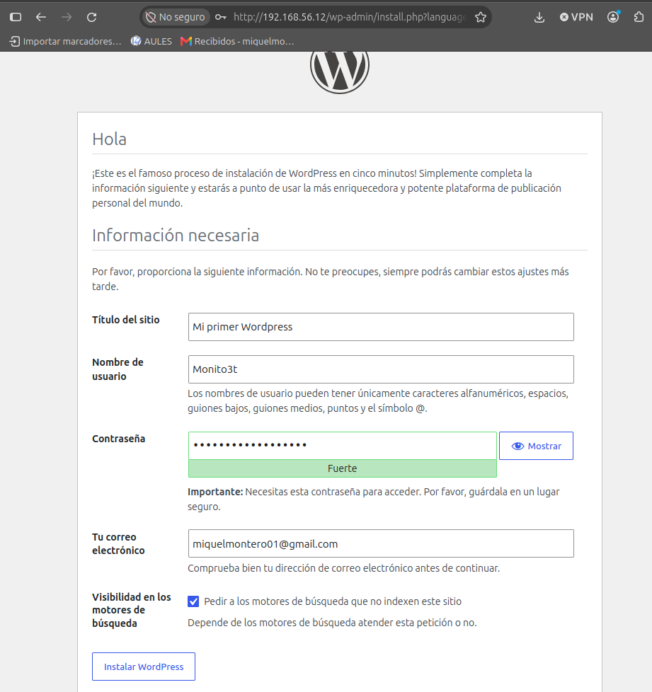
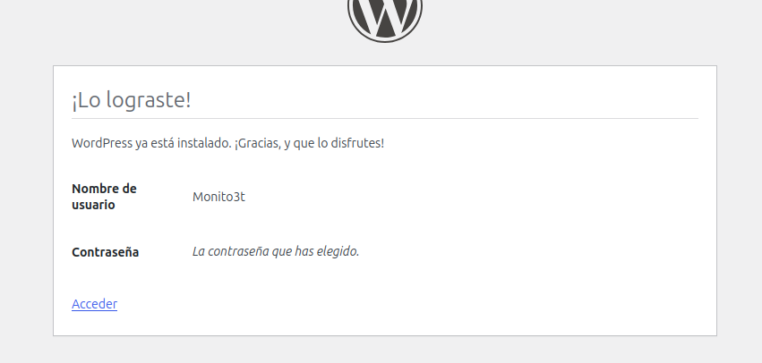
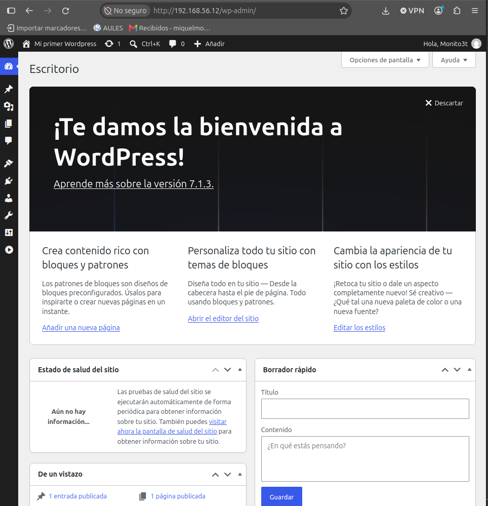

**Reflexión:** ¿Qué partes de la instalación has hecho en la terminal y cuáles en el navegador? ¿Por qué el servidor no necesita tener interfaz gráfica?

**Respuesta:** En la terminal preparé Apache, MariaDB, los ficheros y sus permisos. En el navegador completé el asistente y accedí al panel. El servidor no necesita escritorio porque entrega la web; el navegador del ordenador la representa y permite interactuar con ella.

## 6. Comprobar que WordPress funciona

1. Abre `http://IP_DEL_SERVIDOR` y comprueba el sitio público y el título elegido.
2. Abre `http://IP_DEL_SERVIDOR/wp-admin` e inicia sesión.
3. En **Entradas → Añadir nueva**, crea y publica una entrada de prueba. Comprueba que aparece en la web pública.
4. En la terminal, consulta las tablas:

```bash
sudo mariadb wordpress -e "SHOW TABLES;"
```

La práctica indica que deberían verse unas 12 tablas, cuyos nombres empiezan por `wp_`. Entre ellas, `wp_posts` guarda entradas y páginas, `wp_users` los usuarios y `wp_options` la configuración. WordPress guarda los ficheros del sitio en `/var/www/html/`; la conexión está en `/var/www/html/wp-config.php` (contiene una contraseña, no lo compartas); temas, plugins e imágenes están bajo `/var/www/html/wp-content/`; entradas, usuarios y ajustes están en MariaDB.

**Capturas:**
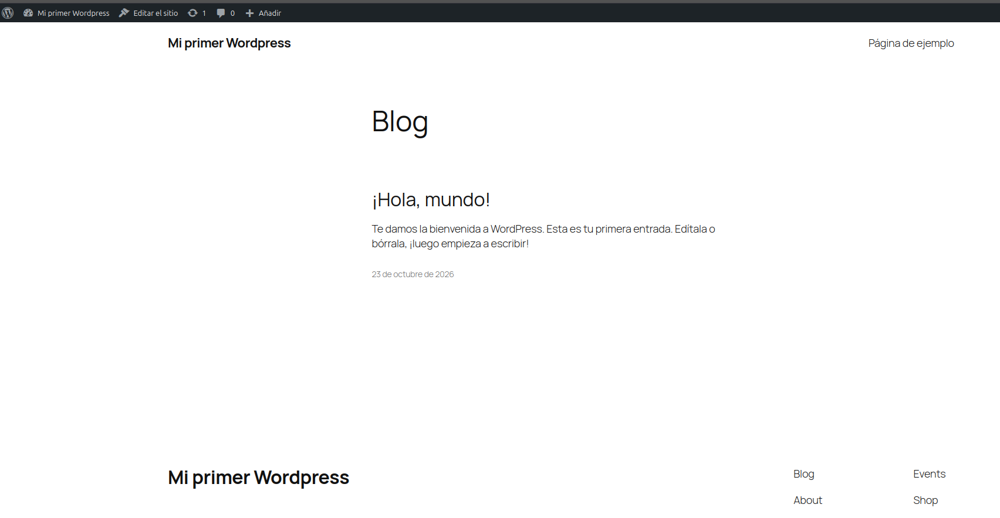
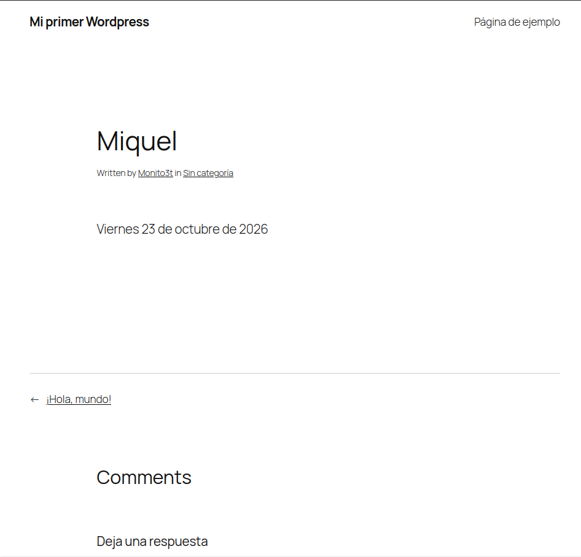
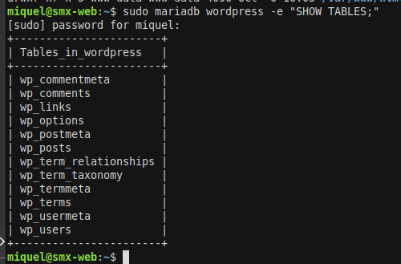

**Reflexión:** ¿Dónde guarda WordPress las entradas que escribes: en ficheros del servidor o en la base de datos? ¿Cómo lo has comprobado?

**Respuesta:** Las guarda en la base de datos MariaDB. Lo comprobé consultando sus tablas con `SHOW TABLES`; la práctica identifica `wp_posts` como la tabla de entradas y páginas.

## 7. Evitar problemas si cambia la IP

La dirección usada durante la instalación puede quedar guardada en la base de datos. Para este laboratorio, la práctica indica configurar WordPress para que use el host de la petición. Edita:

```bash
sudo nano /var/www/html/wp-config.php
```

Busca `That's all` con `Ctrl+W`. Antes de la línea `/* That's all, stop editing!`, añade:

```php
define( 'WP_HOME',    'http://' . $_SERVER['HTTP_HOST'] );
define( 'WP_SITEURL', 'http://' . $_SERVER['HTTP_HOST'] );
```

Guarda con `Ctrl+O`, confirma con Enter y sal con `Ctrl+X`. Comprueba la sintaxis y vuelve a cargar el sitio:

```bash
php -l /var/www/html/wp-config.php
```

**Salida esperada (ejemplo orientativo):** `No syntax errors detected in /var/www/html/wp-config.php`. Verifica el resultado y la web en tus capturas. Esta solución es para el laboratorio; en un servidor real se usaría una dirección fija.


**Capturas:**
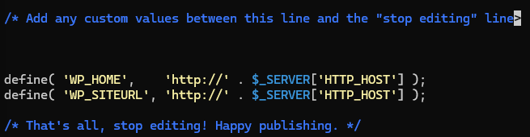


## 8. Dos ajustes para trabajar cómodamente

### 8.1 Enlaces permanentes

Permite que Apache lea las reglas de `.htaccess` en el directorio web:

```bash
sudo nano /etc/apache2/conf-available/wordpress.conf
```

Escribe:

```apache
<Directory /var/www/html>
    AllowOverride All
</Directory>
```

Activa `rewrite` y la configuración, valida y reinicia Apache:

```bash
sudo a2enmod rewrite
sudo a2enconf wordpress
sudo apache2ctl configtest
sudo systemctl restart apache2
```

En WordPress, ve a **Ajustes → Enlaces permanentes → Nombre de la entrada → Guardar cambios**. Abre una entrada y comprueba que su dirección es legible. Comprueba también el fichero:

```bash
ls -la /var/www/html/.htaccess
```

### 8.2 Subidas de hasta 64 MB

```bash
printf 'upload_max_filesize = 64M\npost_max_size = 64M\n' | sudo tee /etc/php/8.3/apache2/conf.d/99-wordpress.ini
sudo systemctl restart apache2
```

En el panel, abre **Medios → Añadir nuevo** y comprueba el tamaño máximo indicado.


**Capturas:** 
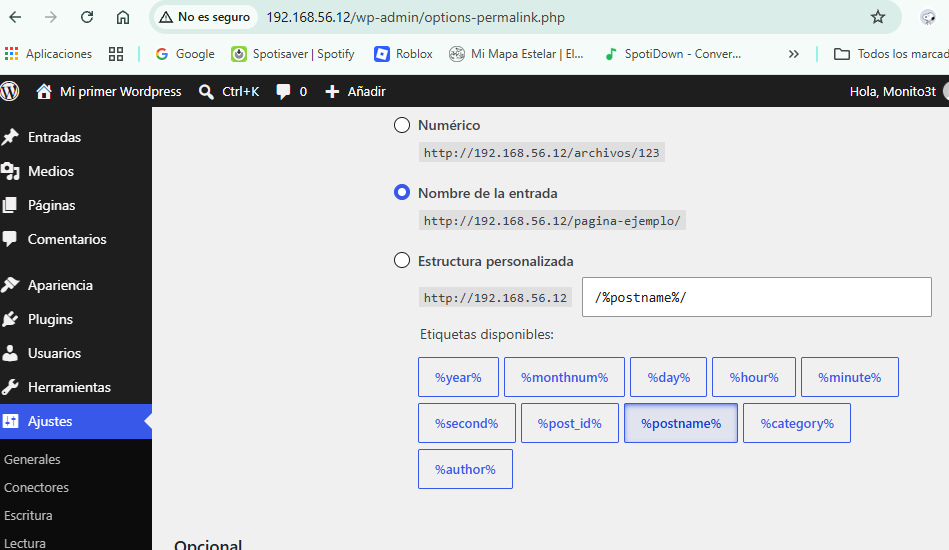
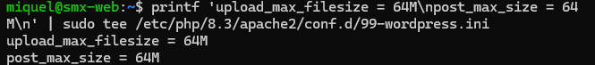

**Reflexión:** ¿Por qué las direcciones “bonitas” dan error 404 si Apache no tiene permitido leer el fichero `.htaccess`?

**Respuesta:** WordPress guarda en `.htaccess` las reglas que permiten a Apache resolver esas direcciones. Si Apache no puede aplicar las reglas del archivo, no sabe cómo dirigir la petición a la entrada y puede devolver 404.

## 9. Qué pasa si MariaDB se para

Detén MariaDB para observar el efecto:

```bash
sudo systemctl stop mariadb
```

Recarga `http://IP_DEL_SERVIDOR`: WordPress debería mostrar un error de conexión con la base de datos. Vuelve a iniciar el servicio y comprueba su estado:

```bash
sudo systemctl start mariadb
systemctl is-active mariadb
```

Recarga la web y comprueba si se recuperó. Si aparece el error, la guía propone comprobar primero el estado del servicio (`systemctl is-active mariadb`; arrancarlo con `sudo systemctl start mariadb` si no está activo) y después probar el acceso con `mariadb -u wp_user -p wordpress`.


**Capturas:**
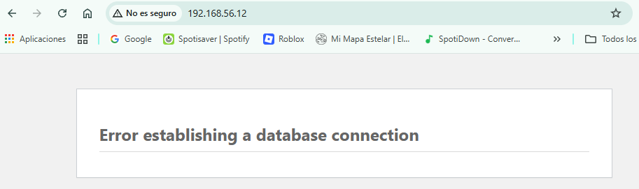
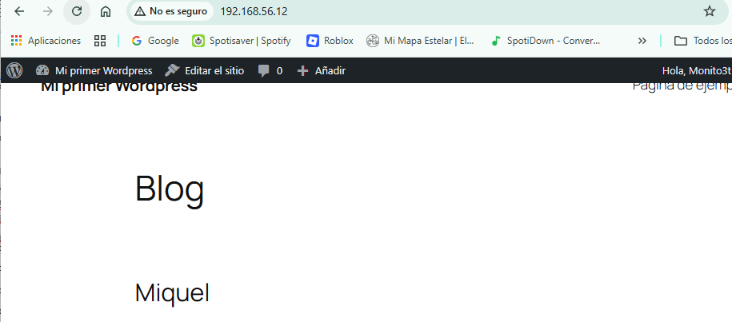

**Reflexión:** Cuando WordPress muestra “Error al establecer una conexión con la base de datos”, ¿qué dos cosas comprobarías y en qué orden?

**Respuesta:** Primero comprobaría que MariaDB está activo y lo arrancaría si hace falta. Después comprobaría las credenciales y el acceso de `wp_user` intentando conectarme a la base `wordpress`.

## 10. Comprobación final

Ejecuta las comprobaciones finales:

```bash
systemctl is-active apache2 mariadb
php -v
ls /etc/apache2/sites-enabled/
sudo mariadb wordpress -e "SHOW TABLES;"
```

Completa la tabla únicamente con resultados verificados en tu servidor:

| Pieza | Comprobación esperada según la práctica | Mi resultado real |
|---|---|---|
| Linux | Ubuntu 24.04 | [Completar] |
| Apache | Apache2, un único sitio, activo | [Completar] |
| MariaDB | MariaDB 10.11, activa y con la base `wordpress` | [Completar] |
| PHP | PHP 8.3 activo | [Completar] |
| WordPress | Instalado en `/var/www/html` y accesible desde el navegador | [Completar] |

**Datos de acceso para guardar en un lugar privado (no publicar contraseñas):**

| Dato | Valor no sensible |
|---|---|
| Dirección de la web | `http://192.168.56.12 ' |
| Panel de administración | `http://192.168.56.12/wp-admin`  |
| Usuario administrador | Monito3t |
| Contraseña | `********`  |

Antes de terminar, crea una nueva instantánea (snapshot) de la máquina virtual.

**Capturas:**
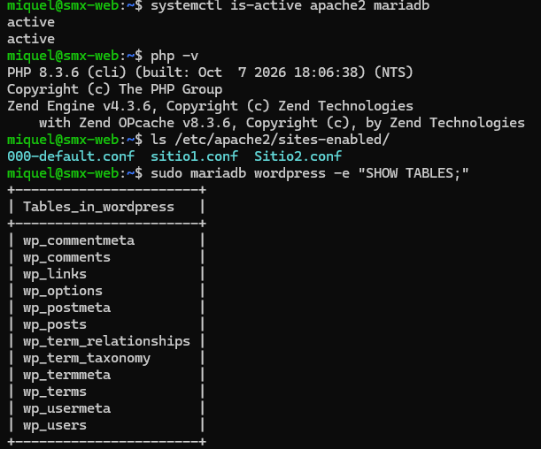

## Conclusiones y problemas encontrados

**Conclusiones:** En esta práctica he instalado WordPress en un servidor Ubuntu 24.04 con Apache, PHP y MariaDB. He aprendido a administrar el servidor mediante SSH y a completar la instalación desde el navegador, sin que el servidor necesite una interfaz gráfica. También he comprobado que WordPress guarda las entradas y la configuración en una base de datos MariaDB, mientras que sus archivos se encuentran en el directorio web. Por último, he configurado los enlaces permanentes y el tamaño máximo de subida, y he observado que WordPress necesita que MariaDB esté activo para mostrar la web.
